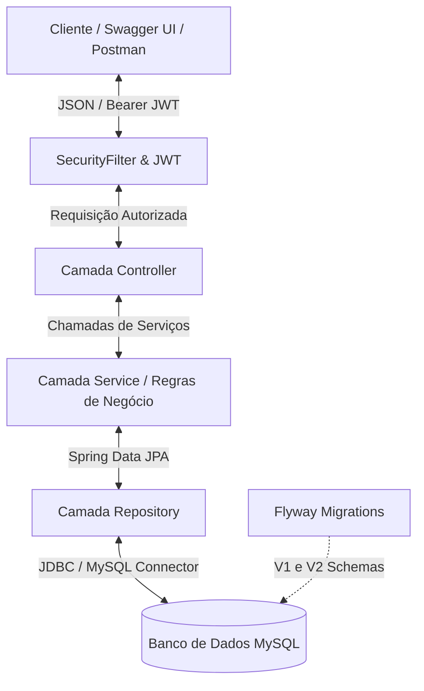

# Aluno Online API 🎓

Este é o projeto **Aluno Online**, uma API REST desenvolvida em **Java 21** com o framework **Spring Boot**, persistência de dados em **MySQL**, versionamento de schema com **Flyway**, autenticação stateless com **Spring Security + JWT** e documentação interativa com **Swagger / OpenAPI 3**.

---

## 🚀 1. Visão Geral do Projeto

O **Aluno Online** é um sistema de controle acadêmico completo e seguro. Ele permite gerenciar os seguintes pilares:
*   **Autenticação e Segurança (`/auth`):** Cadastro e login com geração e validação de tokens JWT (Bearer Token).
*   **Alunos (`/alunos`):** Cadastro e manutenção dos dados básicos de estudantes (rotas protegidas).
*   **Professores (`/professores`):** Cadastro de docentes responsáveis pelas disciplinas (rotas protegidas).
*   **Disciplinas (`/disciplinas`):** Cadastro de matérias escolares, associando-as ao seu respectivo professor e definindo a carga horária (rotas protegidas).
*   **Matrículas (`/matriculas`):** Vinculação entre alunos e disciplinas, registro de notas (`nota1` e `nota2`), cálculo automático de médias para aprovação/reprovação, trancamento e emissão de histórico escolar completo (rotas protegidas).

---

## 🏛️ 2. Arquitetura e Tecnologias

A aplicação adota a **Arquitetura em Camadas (Tiered Architecture)**:



### Stack Tecnológica:
- **Linguagem:** Java 21
- **Framework:** Spring Boot (Data JPA, WebMvc, Security)
- **Banco de Dados:** MySQL 8.x
- **Versionamento de BD:** Flyway (`V1__create_initial_tables.sql` e `V2__create_users_table.sql`)
- **Autenticação & Autorização:** Spring Security + JWT (`com.auth0:java-jwt`)
- **Documentação:** Springdoc OpenAPI 3 (Swagger UI com cadeado de segurança)
- **Produtividade:** Lombok

---

## 🗄️ 3. Versionamento de Banco de Dados (Flyway)

O gerenciamento de esquema DDL foi completamente migrado do Hibernate (`ddl-auto=validate`) para o **Flyway**:

1. **`V1__create_initial_tables.sql`**:
   - Cria as tabelas `aluno`, `professor`, `disciplina` e `matricula_aluno` com chaves primárias autoincrementais, tipos compatíveis e constraints de chave estrangeira.
2. **`V2__create_users_table.sql`**:
   - Cria a tabela `users` com `id`, `login` (único), `password` (hash BCrypt) e `role` (`ADMIN` ou `USER`).

---

## 🔐 4. Autenticação e Segurança (Spring Security + JWT)

A API utiliza autenticação **Stateless** via tokens **JWT**:
* **Endpoints Públicos:**
  * `POST /auth/register`: Cadastra um usuário com senha criptografada via `BCryptPasswordEncoder`.
  * `POST /auth/login`: Autentica credenciais e retorna o token JWT assinado.
  * `/v3/api-docs/**` e `/swagger-ui/**`: Documentação do Swagger aberta para visualização.
* **Endpoints Protegidos:**
  * Todas as operações de `/alunos/**`, `/professores/**`, `/disciplinas/**` e `/matriculas/**` exigem o cabeçalho:
    `Authorization: Bearer <TOKEN_JWT>`
  * O `SecurityFilter` intercepta cada requisição, valida a assinatura e o tempo de expiração do JWT e injeta a autenticação no contexto do Spring Security (`SecurityContextHolder`).

---

## 📑 5. Documentação Interativa com Swagger / OpenAPI

Acesse o Swagger UI em:
```
http://localhost:8080/swagger-ui.html
```

### Como Utilizar o Botão Authorize (Cadeado):
1. Acesse o Swagger UI.
2. Localize o endpoint **`POST /auth/register`** e registre um novo usuário:
   ```json
   {
     "login": "admin",
     "password": "123",
     "role": "ADMIN"
   }
   ```
3. Execute o endpoint **`POST /auth/login`**:
   ```json
   {
     "login": "admin",
     "password": "123"
   }
   ```
4. Copie o token retornado no campo `token`.
5. Clique no botão verde **Authorize** (ou no ícone de cadeado de qualquer rota):
   - Cole o token no campo **Value**.
   - Clique em **Authorize** e feche a janela modal.
6. Todos os endpoints protegidos agora exibirão o cadeado fechado e responderão normalmente às requisições (`200 OK`, `201 CREATED`, etc.). Sem o token, as rotas protegidas retornam `403 Forbidden`.

---

## ⚙️ 6. Configuração e Execução

### Pré-requisitos:
- Java JDK 21+ instalado
- MySQL Server rodando (porta padrão 3306)

### Configuração do Banco (`application.properties`):
Você pode configurar as variáveis de ambiente ou rodar diretamente com as credenciais padrão:
```properties
spring.datasource.url=${DB_URL:jdbc:mysql://localhost:3306/alunoonline?createDatabaseIfNotExist=true&useSSL=false&serverTimezone=UTC&allowPublicKeyRetrieval=true}
spring.datasource.username=${DB_USERNAME:root}
spring.datasource.password=${DB_PASSWORD:root}
```

### Como Iniciar a Aplicação:
No terminal, na raiz do projeto:
```bash
./mvnw spring-boot:run
```
Ou no Windows (cmd / PowerShell):
```cmd
mvnw.cmd spring-boot:run
```
Ao iniciar:
1. O Flyway detectará o banco MySQL e executará automaticamente as migrações `V1` e `V2`.
2. A API subirá na porta `8080`.
3. Abra `http://localhost:8080/swagger-ui.html` para testar.
