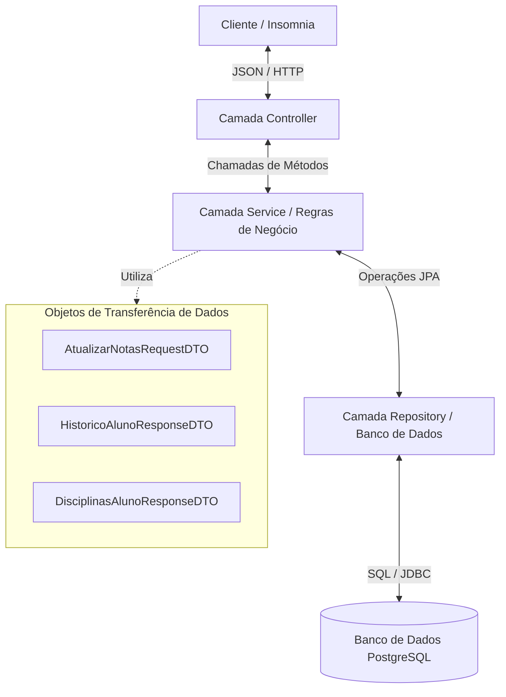

# Aluno Online API 🎓

Este é o projeto **Aluno Online**, uma API REST desenvolvida em **Java 21** com o framework **Spring Boot** e persistência de dados em **PostgreSQL**. O projeto foi estruturado seguindo as melhores práticas de desenvolvimento backend, adotando a arquitetura em camadas e utilizando anotações modernas (como Spring Data JPA e Lombok) para manter o código limpo, legível e de fácil manutenção.

---

## 🚀 1. Explicação do Projeto

O **Aluno Online** é um sistema de controle acadêmico simplificado. Ele permite que instituições de ensino gerenciem seus principais pilares operacionais:
*   **Alunos:** Cadastro e manutenção dos dados básicos de estudantes.
*   **Professores:** Cadastro de docentes responsáveis pelas disciplinas.
*   **Disciplinas:** Cadastro de matérias escolares, associando-as ao seu respectivo professor e definindo a carga horária.
*   **Matrículas (`MatriculaAluno`):** O coração do sistema, responsável por gerenciar a vinculação entre alunos e disciplinas, registrar as notas de avaliações (`nota1` e `nota2`), calcular médias e definir automaticamente a situação acadêmica do estudante (Aprovado ou Reprovado), além de permitir o trancamento de curso.

---

## 🏛️ 2. Arquitetura Utilizada

A aplicação foi desenvolvida seguindo o padrão de **Arquitetura em Camadas (Tiered Architecture)**, o qual garante uma excelente separação de responsabilidades:



1.  **Camada Model (Entidades):** Representa as tabelas do banco de dados mapeadas através do JPA (Java Persistence API). Localizadas em `br.com.alunoonline.api.model`.
2.  **Camada Repository:** Interfaces que estendem `JpaRepository`, fornecendo todos os métodos de persistência (CRUD) de forma transparente. Localizadas em `br.com.alunoonline.api.repository`.
3.  **Camada Service:** Onde reside toda a lógica de negócio do sistema (por exemplo: cálculo de média para aprovação, validação de status de matrícula para trancamento). Localizadas em `br.com.alunoonline.api.service`.
4.  **Camada Controller:** Porta de entrada da API. Recebe as requisições HTTP, valida os corpos (JSON) e direciona para as regras de negócio adequadas na camada Service. Localizadas in `br.com.alunoonline.api.controller`.
5.  **Camada DTO (Data Transfer Objects):** Classes auxiliares para transferir dados customizados e formatar respostas seguras para a API (ex: o Histórico Escolar). Localizadas em `br.com.alunoonline.api.dtos`.

---

## 💻 3. Detalhamento do Código e Entidades

### A. Aluno (`Aluno.java`)
Mapeia a tabela `aluno` no banco de dados.
*   `id` (Long, Chave Primária, Autoincremento)
*   `nome` (String): Nome completo do estudante.
*   `cpf` (String): CPF para fins cadastrais.
*   `email` (String): Endereço eletrônico de contato.

### B. Professor (`Professor.java`)
Mapeia a tabela `professor` no banco de dados.
*   `id` (Long, Chave Primária, Autoincremento)
*   `nome` (String): Nome completo do docente.
*   `cpf` (String): CPF do docente.
*   `email` (String): E-mail corporativo.

### C. Disciplina (`Disciplina.java`)
Mapeia a tabela `disciplina`. Possui um relacionamento **Muitos-para-Um (`@ManyToOne`)** com a entidade Professor.
*   `id` (Long, Chave Primária, Autoincremento)
*   `nome` (String): Nome da matéria.
*   `cargaHoraria` (Integer): Quantidade de horas da matéria.
*   `professor` (Professor): Instância do docente responsável. Mapeado no banco como a chave estrangeira `professor_id`.

### D. Matrícula (`MatriculaAluno.java` & `MatriculaAlunoStatusEnum.java`)
Intermedia a relação entre Aluno e Disciplina. Possui relacionamentos **Muitos-para-Um (`@ManyToOne`)** com ambas as entidades.
*   `id` (Long, Chave Primária, Autoincremento)
*   `aluno` (Aluno): Aluno matriculado (`aluno_id`).
*   `disciplina` (Disciplina): Disciplina vinculada (`disciplina_id`).
*   `nota1` (Double): Primeira nota avaliativa.
*   `nota2` (Double): Segunda nota avaliativa.
*   `status` (MatriculaAlunoStatusEnum): Pode assumir quatro estados:
    *   `MATRICULADO`: Status inicial automático ao efetuar a matrícula.
    *   `TRANCADO`: Definido ao trancar a matrícula (não permite notas).
    *   `APROVADO`: Definido automaticamente se a média `(nota1 + nota2) / 2` for $\ge 7.0$.
    *   `REPROVADO`: Definido automaticamente se a média `(nota1 + nota2) / 2` for $< 7.0$.

---

## 📈 4. Regras de Negócio e Métodos de Matrícula

A classe `MatriculaAlunoService` implementa as principais regras acadêmicas da instituição:

*   **Matricular Aluno (`criarMatricula`)**: Cria o vínculo entre um aluno e uma disciplina. Define por padrão o status inicial como `MATRICULADO`. Valida a existência prévia de ambos no banco de dados.
*   **Trancar Matrícula (`trancarMatricula`)**: Altera o status de uma matrícula específica para `TRANCADO`. Apenas matrículas que estão com o status ativo (`MATRICULADO`) podem ser trancadas. Caso contrário, gera um erro HTTP 400 (Bad Request).
*   **Atualizar Notas (`atualizarNotas`)**: Permite o lançamento parcial de notas (`nota1` ou `nota2`). Se **ambas** as notas forem preenchidas, o sistema calcula a média aritmética e altera de forma automática o status para `APROVADO` (média $\ge 7.0$) ou `REPROVADO` (média $< 7.0$).
*   **Emitir Histórico Escolar (`emitirHistorico`)**: Gera uma estrutura detalhada contendo informações básicas do aluno e um histórico completo das disciplinas que ele cursa ou cursou, com notas, média final calculada em tempo de execução e a situação da disciplina.

---

## 📡 5. Guia de Requisições (Insomnia / Postman)

Abaixo estão detalhadas todas as requisições que podem ser importadas ou configuradas em sua ferramenta de testes HTTP (**Insomnia**).

### A. CRUD Aluno (`/alunos`)

#### 1. Cadastrar Aluno (`POST /alunos`)
*   **Corpo da Requisição (JSON):**
```json
{
  "nome": "Artur Medeiros",
  "cpf": "123.456.789-00",
  "email": "artur@email.com"
}
```
*   **Resposta Esperada (201 Created):**
```json
{
  "id": 1,
  "nome": "Artur Medeiros",
  "cpf": "123.456.789-00",
  "email": "artur@email.com"
}
```

#### 2. Listar Todos os Alunos (`GET /alunos`)
*   **Resposta Esperada (200 OK):**
```json
[
  {
    "id": 1,
    "nome": "Artur Medeiros",
    "cpf": "123.456.789-00",
    "email": "artur@email.com"
  }
]
```

#### 3. Buscar Aluno por ID (`GET /alunos/1`)
*   **Resposta Esperada (200 OK):**
```json
{
  "id": 1,
  "nome": "Artur Medeiros",
  "cpf": "123.456.789-00",
  "email": "artur@email.com"
}
```

#### 4. Atualizar Aluno (`PUT /alunos/1`)
*   **Corpo da Requisição (JSON):**
```json
{
  "nome": "Artur Medeiros de Souza",
  "cpf": "123.456.789-00",
  "email": "artur.novo@email.com"
}
```
*   **Resposta Esperada (200 OK):**
```json
{
  "id": 1,
  "nome": "Artur Medeiros de Souza",
  "cpf": "123.456.789-00",
  "email": "artur.novo@email.com"
}
```

#### 5. Deletar Aluno (`DELETE /alunos/1`)
*   **Resposta Esperada (204 No Content):** (Sem corpo de resposta)

---

### B. CRUD Professor (`/professores`)

#### 1. Cadastrar Professor (`POST /professores`)
*   **Corpo da Requisição (JSON):**
```json
{
  "nome": "Kelson Almeida",
  "cpf": "987.654.321-11",
  "email": "kelson.almeida@uniesp.edu.br"
}
```
*   **Resposta Esperada (201 Created):**
```json
{
  "id": 1,
  "nome": "Kelson Almeida",
  "cpf": "987.654.321-11",
  "email": "kelson.almeida@uniesp.edu.br"
}
```

#### 2. Listar Todos os Professores (`GET /professores`)
*   **Resposta Esperada (200 OK)**

---

### C. CRUD Disciplina (`/disciplinas`)

#### 1. Cadastrar Disciplina (`POST /disciplinas`)
*   **Corpo da Requisição (JSON):**
```json
{
  "nome": "Desenvolvimento Web com Spring Boot",
  "cargaHoraria": 80,
  "professor": {
    "id": 1
  }
}
```
*   **Resposta Esperada (201 Created):**
```json
{
  "id": 1,
  "nome": "Desenvolvimento Web com Spring Boot",
  "cargaHoraria": 80,
  "professor": {
    "id": 1,
    "nome": "Kelson Almeida",
    "cpf": "987.654.321-11",
    "email": "kelson.almeida@uniesp.edu.br"
  }
}
```

---

### D. Métodos de Matrícula (`/matriculas`)

#### 1. Efetuar Nova Matrícula (`POST /matriculas`)
*   **Corpo da Requisição (JSON):**
```json
{
  "aluno": {
    "id": 1
  },
  "disciplina": {
    "id": 1
  }
}
```
*   **Resposta Esperada (201 Created):** (Sem corpo de resposta, tabela `matricula_aluno` atualizada com status `MATRICULADO`)

#### 2. Trancar Matrícula (`PATCH /matriculas/trancar/1`)
*   **Resposta Esperada (204 No Content):** (Altera o status da matrícula ID 1 para `TRANCADO`)

#### 3. Lançar/Atualizar Notas (`PATCH /matriculas/atualizar-notes/1` ou `/matriculas/atualizar-notas/1`)
*   **Corpo da Requisição (JSON):**
```json
{
  "nota1": 8.5,
  "nota2": 7.5
}
```
*   **Resposta Esperada (204 No Content):** (Atualiza as notas e altera automaticamente o status para `APROVADO`, pois a média é 8.0)

#### 4. Emitir Histórico Escolar (`GET /matriculas/emitir-historico/1`)
*   **Resposta Esperada (200 OK):**
```json
{
  "nomeAluno": "Artur Medeiros",
  "emailAluno": "artur@email.com",
  "cpfAluno": "123.456.789-00",
  "disciplinas": [
    {
      "nomeDisciplina": "Desenvolvimento Web com Spring Boot",
      "nomeProfessor": "Kelson Almeida",
      "nota1": 8.5,
      "nota2": 7.5,
      "media": 8.0,
      "status": "APROVADO"
    }
  ]
}
```

---

## 🗄️ 6. Tabelas do Banco de Dados no DBeaver (Visualização Conceitual)

Graças ao Hibernate configurado com `ddl-auto=update`, as tabelas são criadas automaticamente no PostgreSQL. Abaixo estão representados os dados utilizados para testes conforme visualizados nas tabelas através do **DBeaver**:

### Tabela: `aluno`
| id (PK) | nome                    | cpf            | email                 |
|:--------|:------------------------|:---------------|:----------------------|
| 1       | Artur Medeiros          | 123.456.789-00 | artur@email.com       |
| 2       | Maria Silva Oliveira    | 111.222.333-44 | maria.silva@email.com |

### Tabela: `professor`
| id (PK) | nome           | cpf            | email                        |
|:--------|:---------------|:---------------|:-----------------------------|
| 1       | Kelson Almeida | 987.654.321-11 | kelson.almeida@uniesp.edu.br |

### Tabela: `disciplina`
| id (PK) | nome                                 | carga_horaria | professor_id (FK) |
|:--------|:-------------------------------------|:--------------|:------------------|
| 1       | Desenvolvimento Web com Spring Boot  | 80            | 1                 |
| 2       | Estrutura de Dados em Java           | 60            | 1                 |

### Tabela: `matricula_aluno`
| id (PK) | aluno_id (FK) | disciplina_id (FK) | nota1 | nota2 | status       |
|:--------|:--------------|:-------------------|:------|:------|:-------------|
| 1       | 1             | 1                  | 8.5   | 7.5   | APROVADO     |
| 2       | 1             | 2                  | NULL  | NULL  | MATRICULADO  |
| 3       | 2             | 1                  | 4.0   | 5.0   | REPROVADO    |

---

## 🛠️ Como Executar a Aplicação localmente

1.  **Pré-requisitos:** Certifique-se de ter o Docker em execução com o banco de dados PostgreSQL rodando na porta `5438` (ou ajuste as credenciais e porta em `src/main/resources/application.properties`).
2.  **Compilar e Executar:**
    Abra a pasta do projeto no seu terminal e execute:
    ```bash
    ./mvnw spring-boot:run
    ```
3.  **Acessar a API:**
    A aplicação estará disponível em `http://localhost:8080`. Você pode testar todos os endpoints listados utilizando o Insomnia!
